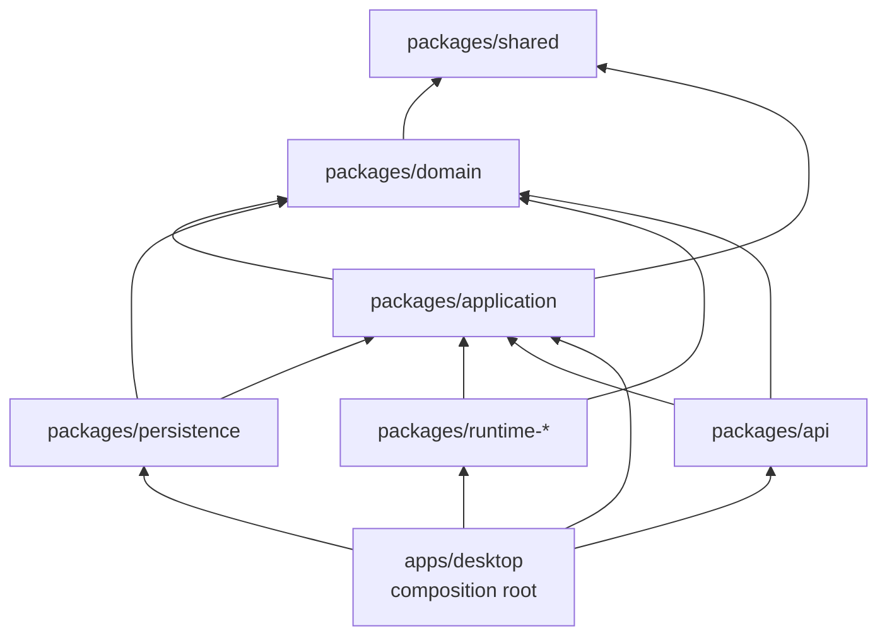

<p align="center">
  
</p>

<p align="center">
  <strong>T3 code meets Grok Bot</strong>
</p>

<p align="center">
  Create bots that run on your own machines and use the harnesses you already pay for.
</p>

<p align="center">
  <a href="#quick-start">Quick start</a> ·
  <a href="#what-it-is">What it is</a> ·
  <a href="#architecture">Architecture</a> ·
  <a href="#development">Development</a> ·
  <a href="#license">License</a>
</p>

---

## What?

bebots is a meta-harness that lets you use your existing subscriptions to create
and run your own bots. It aims to give you as much as freedom as possible to
manage and run them on your own hardware. It integrates directly with provider harnesses so
you use the subscriptions you already pay for.

Each bot lives in its own directory and set up so harnesses can treat it like a regular project.

## Why?

- Grok Bot is a really great tool but hides the finer details of the models and harnesses. bebots
gives you back that control.

## How different?

This _is_ another open source alternative to Grok Bot. However bebots plans to differ on the following:

- Use 3rd party harnesses instead of creating a new one
- That's it (for now)


## Quick start

Requires [Bun](https://bun.sh).

```bash
bun install
bun run dev
```

Headless (no Electron window) — useful for API testing:

```bash
bun run dev -- --headless
# or: BEBOTS_HEADLESS=1 bun run dev
```

Port and auth token are written under the app user-data directory (`api-port.txt`, `api-token.txt`).

## Architecture

Monorepo. Dependencies flow inward; the desktop app is the composition root.



| Package                     | Role                                |
| --------------------------- | ----------------------------------- |
| `packages/domain`           | Entities, IDs, validators           |
| `packages/application`      | Use cases + `AgentRuntime` contract |
| `packages/persistence`      | Local storage                       |
| `packages/runtime-opencode` | OpenCode adapter                    |
| `packages/api`              | HTTP API (Effect `HttpApi`)         |
| `apps/desktop`              | Electron UI + composition root      |

See [`docs/architecture.md`](docs/architecture.md) for dependency rules and the runtime adapter contract.

## Development

```bash
bun run typecheck
bun run lint
bun run test
bun run build
```

| Script                    | What it does                     |
| ------------------------- | -------------------------------- |
| `bun run dev`             | Desktop app (or headless server) |
| `bun run typecheck`       | Project-wide TypeScript          |
| `bun run lint` / `format` | ESLint / Prettier                |
| `bun run test`            | Vitest                           |

## License

Licensed under the [Apache License 2.0](LICENSE).
