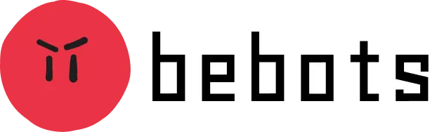
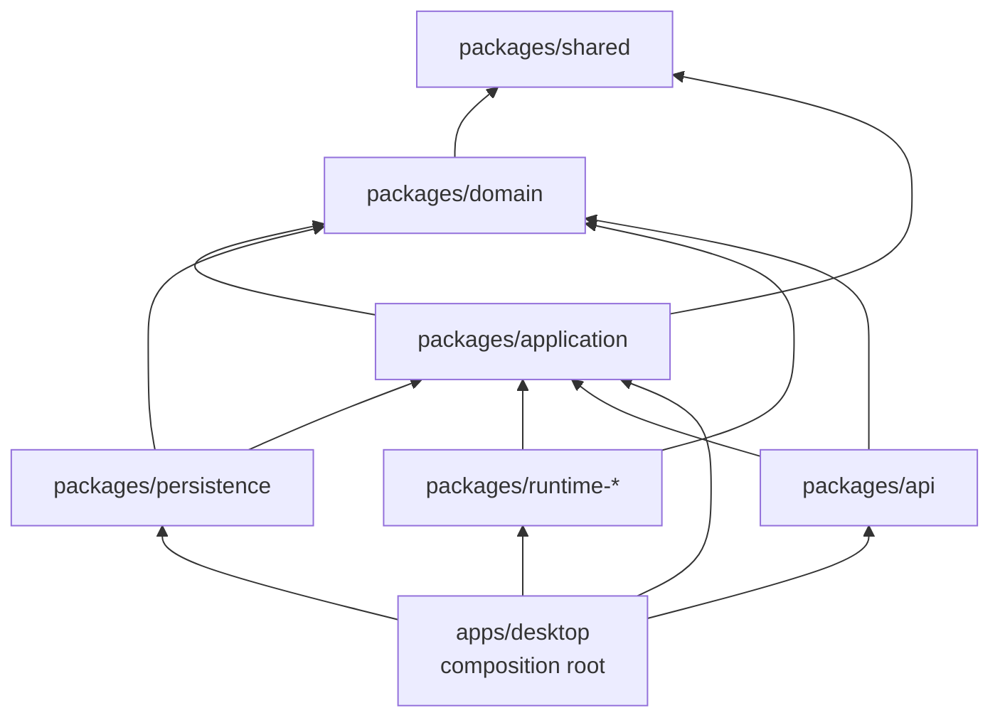

<p align="center">
  
</p>

<p align="center">
  <strong>A local-first hub for persistent AI bots.</strong>
</p>

<p align="center">
  Create bots with durable personas, private workspaces, and memory.<br />
  Let them collaborate, run on schedules, and talk to you — all on your machine.
</p>

<p align="center">
  <a href="#quick-start">Quick start</a> ·
  <a href="#what-it-is">What it is</a> ·
  <a href="#architecture">Architecture</a> ·
  <a href="#development">Development</a> ·
  <a href="#license">License</a>
</p>

---

## What it is

bebots is a desktop app for building a **persistent AI workforce** — not another disposable chat window.

Each bot is a lasting identity: persona, home directory, notes, conversations, tools, and schedules. Bots can message you and each other. The app owns coordination, permissions, and run state; a pluggable runtime (OpenCode today) does the thinking.

| Principle               | Meaning                                              |
| ----------------------- | ---------------------------------------------------- |
| **Local-first**         | State and workspaces live on your machine            |
| **API-first**           | Desktop UI and external clients share one HTTP API   |
| **Persistent identity** | Persona and knowledge survive runs and runtime swaps |
| **Safe by default**     | Local bind, explicit permissions, auditable runs     |

## Quick start

Requires [Bun](https://bun.sh).

```bash
bun install
bun run dev
```

Headless (no Electron window) — useful for API testing:

```bash
bun run dev -- --headless
# or: BEBOTS_HEADLESS=1 bun run dev
```

Port and auth token are written under the app user-data directory (`api-port.txt`, `api-token.txt`).

## Architecture

Monorepo. Dependencies flow inward; the desktop app is the composition root.



| Package                     | Role                                |
| --------------------------- | ----------------------------------- |
| `packages/domain`           | Entities, IDs, validators           |
| `packages/application`      | Use cases + `AgentRuntime` contract |
| `packages/persistence`      | Local storage                       |
| `packages/runtime-opencode` | OpenCode adapter                    |
| `packages/api`              | HTTP API (Effect `HttpApi`)         |
| `apps/desktop`              | Electron UI + composition root      |

See [`docs/architecture.md`](docs/architecture.md) for dependency rules and the runtime adapter contract.

## Development

```bash
bun run typecheck
bun run lint
bun run test
bun run build
```

| Script                    | What it does                     |
| ------------------------- | -------------------------------- |
| `bun run dev`             | Desktop app (or headless server) |
| `bun run typecheck`       | Project-wide TypeScript          |
| `bun run lint` / `format` | ESLint / Prettier                |
| `bun run test`            | Vitest                           |

## License

Licensed under the [Apache License 2.0](LICENSE).
